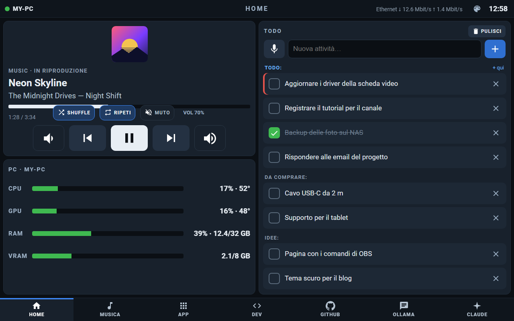
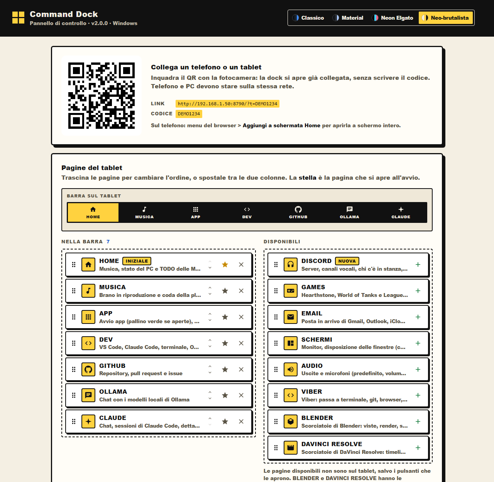

# Command Dock

Trasforma un **vecchio tablet Android** (anche Android 4.x, con il suo browser) in una **Stream Deck wireless** per il PC.
Sul PC (Windows o Linux) gira un piccolo server Node.js; il tablet apre una pagina web: niente app da installare.



## Cosa fa

- **Pulsanti** configurabili da JSON: app, scorciatoie, testo, macro, comandi. Un pallino verde dice se l'app è già aperta.
- **Musica**: copertina, coda, salto a un punto del brano, shuffle, ripeti e volume dell'app (Apple Music e YouTube nel browser, Spotify, VLC...).
- **Stato del PC**: CPU, RAM, GPU NVIDIA (uso, temperatura, VRAM) e rete.
- **Discord**: server, canali vocali, chi parla, mute, webcam e Go Live.
- **Audio**: uscita e microfono predefiniti, volume di ogni app.
- **Schermi**: su quale monitor aprire le app, finestre nelle zone (come Snap), desktop virtuali.
- **Claude Code**: le sessioni dell'app desktop divise per sezioni; scrivi o detti dal tablet e il messaggio parte sul PC. Consumi dell'abbonamento.
- **TODO** sulle Memo di Windows (o in locale su Linux), con dettatura.
- Email in sola lettura, GitHub, Ollama, scorciatoie per Blender e DaVinci Resolve.
- **Quattro temi** (Classico, Material, Neon Elgato, Neo-brutalista) sul tablet e nel pannello del PC.
- **Pannello di controllo** sul PC per ordinare pagine e pulsanti con il trascinamento, e **QR code** per collegare un telefono.

| Pulsanti (pagina APP) | Sessioni di Claude Code |
|---|---|
|  |  |

### Pannello di controllo sul PC

| Neon Elgato | Neo-brutalista | Material |
|---|---|---|
|  |  |  |

## Avvio rapido

```bash
cd android-command-dock
# Windows: doppio clic su start.bat      Linux: ./start.sh
```

Al primo avvio lo script installa le dipendenze, crea il `.env` con un **codice di accesso** casuale e mostra
l'indirizzo da aprire sul tablet (e un QR code). Il tablet e il PC devono stare sulla stessa rete.

Vuoi solo vedere com'è? `npm run demo` (in `android-command-dock/`) apre una dock con **dati finti** su
`http://127.0.0.1:8790/?t=DEMO1234`.

La guida completa (pagine, configurazione, Windows e Linux, sicurezza, problemi comuni) è in
[`android-command-dock/README.md`](android-command-dock/README.md).

## Requisiti

- PC con **Windows 10/11** o **Linux** (KDE o GNOME) e **Node.js 18+**.
- Un tablet o telefono con un browser qualsiasi, anche molto vecchio (il client è in ES5, senza flexbox).

## Sicurezza

La dock risponde solo con il codice di accesso, il pannello solo da `127.0.0.1`, e i segreti nel `.env` vengono cifrati.
Alcune funzioni (scrivere testo sul PC, far lavorare Claude Code) danno al tablet molto potere: non condividere il codice.
Dettagli nella sezione *Sicurezza* della guida.

## Licenza

[MIT](LICENSE) © 2026 Stefano Di Patti
