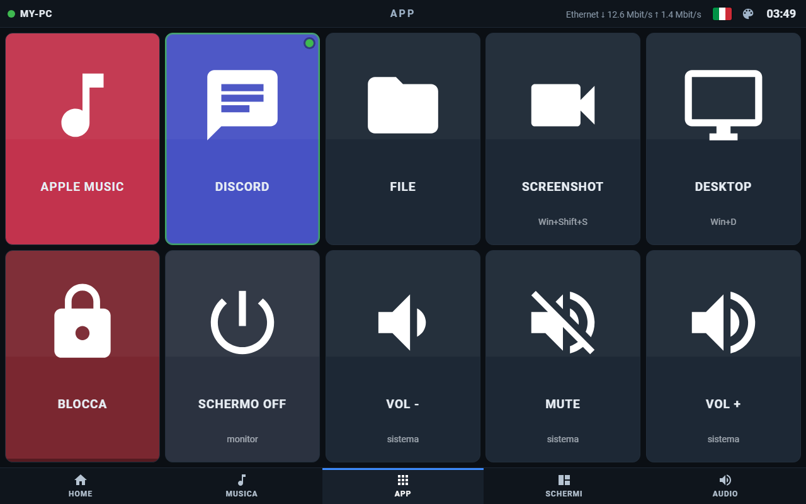
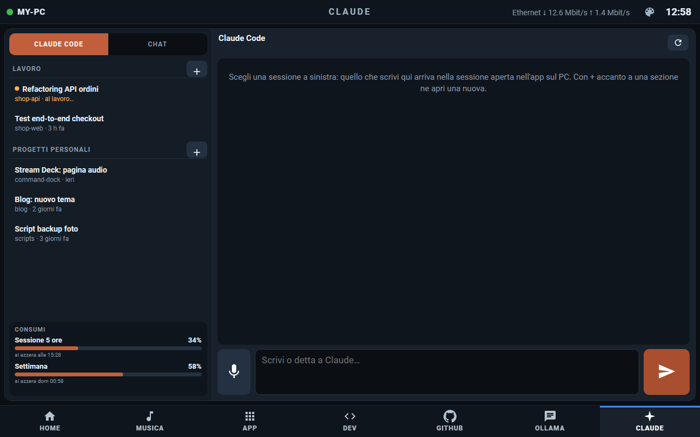
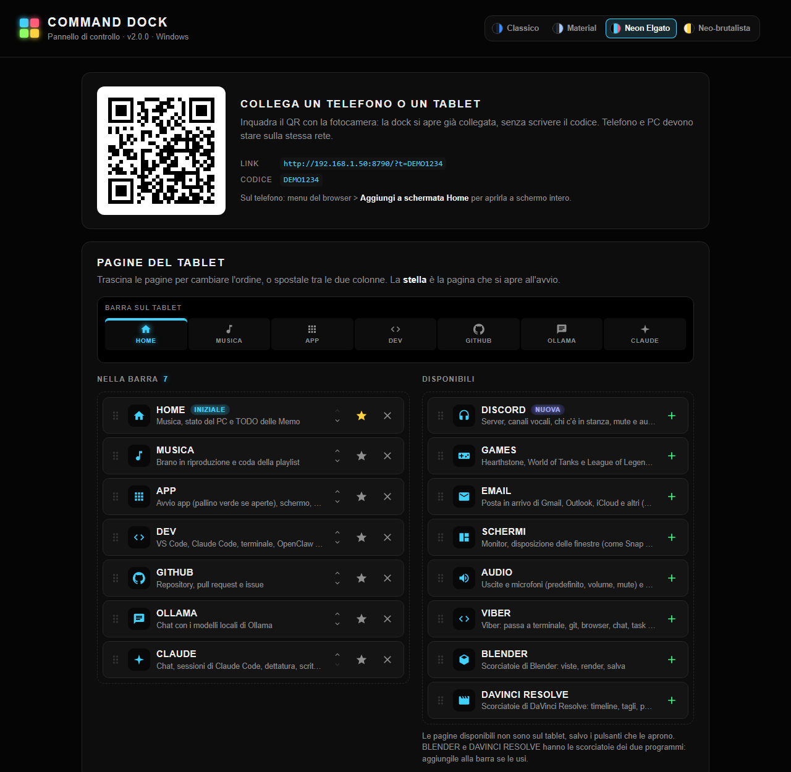
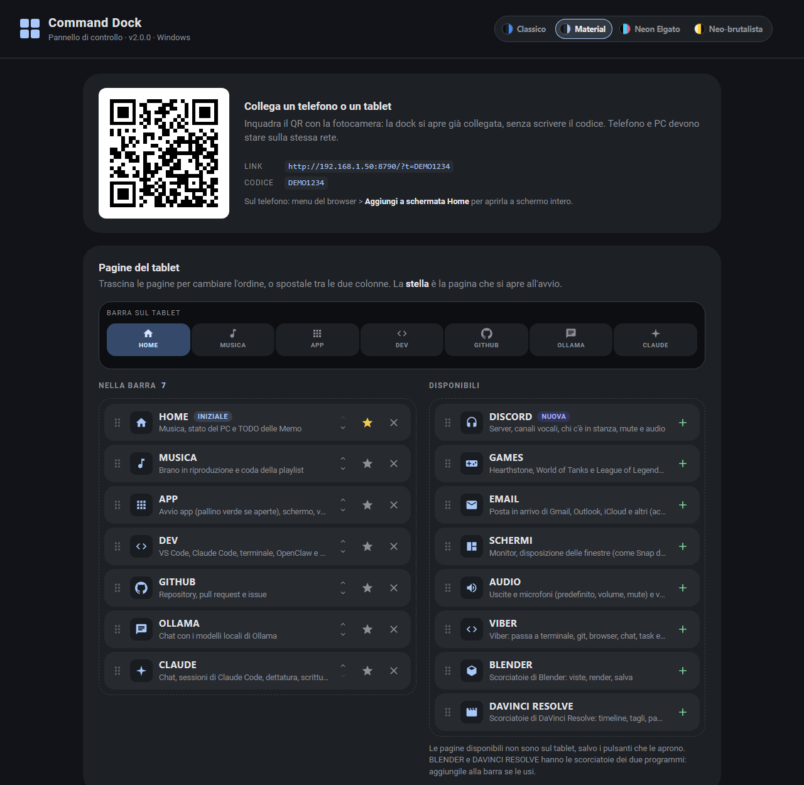

# Vibe Deck

Trasforma un **vecchio tablet Android** (anche Android 4.x, con il suo browser) in una **Stream Deck wireless** per il PC.
Sul PC (Windows o Linux) gira un piccolo server Node.js; il tablet apre una pagina web: niente app da installare.


## Cosa fa

- **Pulsanti** configurabili: app, scorciatoie, testo, macro, comandi. Un pallino verde dice se l'app è già aperta.
- **Musica**: copertina, coda, salto a un punto del brano, shuffle, ripeti e volume dell'app (Apple Music e YouTube nel browser, Spotify, VLC...).
- **Stato del PC**: CPU, RAM, GPU NVIDIA (uso, temperatura, VRAM) e rete.
- **Discord**: server, canali vocali, chi parla, mute, webcam e Go Live.
- **Audio**: uscita e microfono predefiniti, volume di ogni app.
- **Schermi**: su quale monitor aprire le app, finestre nelle zone (come Snap), desktop virtuali, trascinamento delle finestre.
- **Claude Code**: le sessioni dell'app desktop divise per sezioni; scrivi o detti dal tablet e il messaggio parte sul PC. Consumi dell'abbonamento.
- **Giochi** scelti dal pannello, con la loro icona. **Email** da Thunderbird, in sola lettura.
- **TODO** sulle Memo di Windows (o in locale su Linux), con dettatura. GitHub, Ollama, Viber, scorciatoie per Blender e DaVinci Resolve.
- **Quattro temi** (Classico, Material, Neon Elgato, Neo-brutalista) sul tablet e nel pannello del PC.
- **Pannello di controllo** sul PC per ordinare pagine e pulsanti con il trascinamento, e **QR code** per collegare un telefono.

| Pulsanti (pagina APP) | Sessioni di Claude Code |
|---|---|
|  |  |

### Pannello di controllo sul PC

| Neon Elgato | Neo-brutalista | Material |
|---|---|---|
|  |  |  |

## Indice

1. [Guida all'installazione](#1-guida-allinstallazione): requisiti, Windows, Linux, collegare il tablet, aggiornare.
2. [Guida utente](#2-guida-utente): il tablet, le pagine, il pannello di controllo, i servizi da collegare.
3. [Guida per sviluppatori](#3-guida-per-sviluppatori-personalizza-la-tua-vibe-deck): pulsanti, pagine, azioni, widget e codice.

Il riferimento completo di ogni funzione è in [`app/README.md`](app/README.md).

---

# 1. Guida all'installazione

## Requisiti

- PC con **Windows 10/11** o **Linux** (KDE Plasma consigliato; GNOME va, senza la pagina SCHERMI).
- **Node.js 18+**: se manca, lo script di avvio propone di installarlo.
- Un tablet o telefono con un browser qualsiasi, anche molto vecchio (il client è in ES5).
- PC e tablet sulla **stessa rete**.

## Scaricare

```bash
git clone https://github.com/StefanoDiPatti/vibe-deck.git
cd vibe-deck/app
```

(oppure scarica lo ZIP da GitHub ed estrailo; tutto quello che serve è nella cartella `app/`).

Vuoi solo vedere com'è? `npm run demo` (in `app/`, dopo `npm install`) apre una dock con **dati finti** su
`http://127.0.0.1:8790/?t=DEMO1234`, senza toccare la tua configurazione.

## Windows

1. Doppio clic su **`app\start.bat`**.
2. Al primo avvio lo script fa tutto da solo: propone di installare Node.js (con winget) se manca, installa le dipendenze,
   crea il file `.env` con un **codice di accesso** casuale e la tua configurazione in `app\config\`.
3. Poi chiede se aprire la porta nel firewall, creare il collegamento **Vibe Deck** sul desktop e attivare l'avvio automatico.
4. La dock gira **in background**: la trovi come icona (quattro quadratini blu) vicino all'orologio, anche sotto la freccetta.
   Dal suo menu apri il pannello di controllo, vedi indirizzo e codice per il tablet, apri il log, riavvii o chiudi la dock.

> **Rete "Pubblica":** la regola del firewall vale solo per le reti private. Se il tablet non si collega,
> imposta la rete di Windows come *Privata* (Impostazioni → Rete e Internet → la tua rete).

Per ripetere le domande: `start.bat --setup`. Per vedere i messaggi in una finestra: `start.bat --console`.

## Linux

```bash
cd vibe-deck/app
./start.sh            # al primo avvio: dipendenze, .env, configurazione, domande come su Windows
```

Programmi consigliati (servono a musica, scorciatoie e pagina SCHERMI):

```bash
# Arch / CachyOS
sudo pacman -S playerctl wtype
paru -S kdotool                  # pagina SCHERMI (KDE Plasma 6)
# Debian / Ubuntu
sudo apt install playerctl xdotool wtype pulseaudio-utils
# firewall, se attivo
sudo ufw allow 8787/tcp
```

Per farla girare in background con un'icona sul desktop e nel menu delle app:

```bash
scripts/linux/vibe-deck.sh install            # icona (doppio clic = avvia e apre il pannello)
scripts/linux/vibe-deck.sh install autostart  # avvio automatico all'accesso (facoltativo)
```

## Collegare il tablet

1. Il modo più veloce: inquadra il **QR code** in cima al pannello di controllo (o nel terminale all'avvio).
2. Oppure apri sul tablet il **link diretto** che trovi nel menu dell'icona, per esempio `http://192.168.1.50:8787/?t=ABCD2345`:
   il codice viene salvato e non te lo chiede più.
3. Chrome: menu → *Aggiungi a schermata Home*. Dall'icona la dock si apre a schermo intero.
4. Per tenere lo schermo acceso: *Opzioni sviluppatore → Rimani attivo* (con il tablet in carica).

Il **pannello di controllo** si apre solo dal PC: doppio clic sull'icona Vibe Deck, oppure `http://127.0.0.1:8787/control`.

## Aggiornare

```bash
cd vibe-deck
git pull
```

Poi riavvia la dock (menu dell'icona → *Riavvia*). I file di configurazione che non hai mai modificato passano da soli
alla versione nuova; quelli che hai cambiato restano come sono. I tuoi dati (`app/data/`, `app/config/`, `app/.env`) non sono in git.

Se qualcosa non va: [Problemi comuni](app/README.md#problemi-comuni).

---

# 2. Guida utente

## Il tablet

- **Barra in basso**: le pagine. Quali e in che ordine lo scegli dal pannello di controllo.
- **Pulsanti**: un tocco esegue l'azione. Quelli con la barra arancione in basso (es. BLOCCA) vanno **tenuti premuti** circa
  un secondo. Volume e annulla si ripetono se tieni premuto. Il **pallino verde** dice che l'app è aperta.
- **In alto a destra**: rete del PC, velocità, il pulsante dei **temi** (tavolozza) e l'orologio (toccalo per lo schermo intero).
- **Batteria**: dopo un minuto senza tocchi la dock aggiorna i dati più lentamente; dopo 10 minuti parte il **salvaschermo**
  (orologio fioco). Un tocco la riattiva.
- **Telefono**: funziona anche da telefono, in orizzontale.
- Per aprire direttamente una pagina: `http://IP:8787/#media`, `#claude`, `#games`...

## Le pagine

| Pagina | Cosa fa | Windows | Linux |
|---|---|---|---|
| HOME | Musica, stato del PC e TODO | ✅ | ✅ (TODO in una lista della dock invece delle Memo) |
| MUSICA | Copertina, coda, posizione nel brano, volume dell'app | ✅ | ✅ con `playerctl` |
| APP | Pulsanti delle app e del sistema | ✅ | ✅ (Terminale, Monitor di sistema, Spectacle al posto di quelli di Windows) |
| DEV | Strumenti da sviluppatore | ✅ | ✅ |
| GITHUB | Repository, PR, issue e CI; guida ai comandi git | ✅ | ✅ |
| OLLAMA | Chat con un modello locale | ✅ | ✅ |
| CLAUDE | Sessioni di Claude Code, consumi, chat | ✅ (app desktop di Claude) | ✅ (con `claude -p`) |
| DISCORD | Server, canali vocali, mute, webcam, Go Live | ✅ | ✅ |
| GAMES | I tuoi giochi, con pallino verde se aperti | ✅ | ✅ |
| EMAIL | Posta in arrivo da Thunderbird, in sola lettura | ✅ | ✅ |
| SCHERMI | Monitor, zone delle finestre, desktop virtuali, trascinamento | ✅ | ⚠️ solo KDE Plasma 6 con `kdotool` |
| AUDIO | Uscita, microfono, volume di ogni app | ✅ | ✅ con `pactl` |
| VIBER | Pannelli, progetti e task di Viber | ✅ | ✅ |
| BLENDER, DAVINCI RESOLVE | Scorciatoie dei due programmi | ✅ | ✅ |
| DESKTOP VIRTUALI | Guida alle scorciatoie | ❌ (è dentro SCHERMI) | ✅ |

Le pagine da DISCORD in giù all'inizio non sono nella barra: le aggiungi dal pannello di controllo.

## Il pannello di controllo

Si apre sul PC (doppio clic sull'icona **Vibe Deck**). Da qui:

- **Pagine**: trascinale per cambiare l'ordine della barra, spostale tra *Nella barra* e *Disponibili*; la stella sceglie la pagina iniziale.
- **Pulsanti delle pagine**: riordinali o nascondili; la griglia si adatta da sola. **Salva sul tablet** e il tablet si aggiorna.
- **Giochi**: *Aggiungi un gioco* apre il selettore di file; scegli nome e icona (quella del file o una trovata sul web).
- **Email**: stato di Thunderbird, account trovati e quali mostrare sul tablet.
- **Discord**: collegamento e autorizzazione.
- **QR code** per collegare un telefono o un tablet, e il **tema** del pannello.

## Servizi da collegare

| Servizio | Cosa fare | Dettagli |
|---|---|---|
| Email | Installa [Thunderbird](https://www.thunderbird.net/download/) e aggiungi lì i tuoi account (anche università e lavoro) | [Email](app/README.md#email) |
| Discord | Crea un'app gratuita nel Developer Portal e autorizzala dal pannello | [Discord](app/README.md#discord) |
| Apple Music web, YouTube | Installa l'estensione del browser inclusa (`app/extension/`) | [Musica](app/README.md#musica) |
| Claude Code | Claude Code installato sul PC (`claude` nel terminale) | [Claude](app/README.md#claude) |
| GitHub | Facoltativo: `gh auth login`, oppure `GITHUB_TOKEN` nel `.env` | [GitHub](app/README.md#github) |

---

# 3. Guida per sviluppatori: personalizza la tua Vibe Deck

## Dove stanno le cose

Tutti i file di configurazione sono **JSON con commenti `//`**. Quando salvi, il tablet si aggiorna da solo, senza riavviare.

| File (in `app/`) | Cosa contiene | In git? |
|---|---|---|
| `config/dock.json` | pagine, pulsanti e widget | no, è tuo |
| `config/apps.json` | programmi avviabili (percorsi per Windows e Linux) | no |
| `config/commands.json` | comandi consentiti (whitelist) | no |
| `config/services.json` | musica, Claude, GitHub, Ollama, TODO, tempi del tablet | no |
| `config/layout.json` | scelte del pannello (ordine delle pagine e dei pulsanti) | no, lo scrive il pannello |
| `config/defaults/*.json` | i default del progetto, copiati in `config/` al primo avvio | sì |
| `data/` | dati personali: giochi, account da mostrare, log, segreti cifrati | no |
| `.env` | porta, codice di accesso, token e chiavi API | no |

**Regola:** per personalizzare modifica i file in `config/`, mai quelli in `config/defaults/`.
Per tornare al default cancella il file da `config/`.

## Aggiungere un pulsante

In `config/dock.json`, dentro `tiles` della pagina:

```json
{ "id": "obs", "label": "OBS", "icon": "camera", "color": "#5b3fa0", "action": { "type": "launch", "app": "obs" } }
```

e in `config/apps.json`:

```json
"obs": {
  "label": "OBS Studio",
  "toggle": true,
  "windows": { "path": "C:\\Program Files\\obs-studio\\bin\\64bit\\obs64.exe", "cwd": "C:\\Program Files\\obs-studio\\bin\\64bit" },
  "linux": { "path": "obs" }
}
```

- `"id"`: nome fisso del pulsante; il pannello lo usa per ricordare ordine e pulsanti nascosti.
- `"sub"`: seconda riga. `"color"`: colore (si adatta al tema). `"w"`/`"h"`: celle occupate.
- `"confirm": true`: va tenuto premuto. `"repeat": true`: si ripete tenendo premuto. `"hidden": true`: nascosto finché non lo mostri dal pannello.
- `"toggle": true` (in `apps.json`): pallino verde se aperta e un altro tocco la chiude. `"whenRunning": "focus"`: se è aperta la porta in primo piano.
- Nei percorsi: `%USERPROFILE%`, `%LOCALAPPDATA%`, `~`, `$HOME`, `*` per la versione; anche collegamenti `.lnk` e `shell:AppsFolder\<AppID>` (app dello Store).

## Un pulsante diverso su Windows e Linux

```json
{ "id": "terminal", "label": "POWERSHELL", "linux": { "label": "TERMINALE" }, "action": { "type": "launch", "app": "powershell" } },
{ "id": "viber", "os": "linux", "label": "VIBER", "action": { "type": "launch", "app": "viber" } }
```

- `"os": "linux"` (o `"windows"`): il pulsante, o la pagina intera, c'è solo su quel sistema.
- `"linux": { ... }` (o `"windows"`): i campi che cambiano su quel sistema, anche l'`action`.
- In `apps.json` e `commands.json` la variante `"linux"` può essere una **lista di alternative**: vale la prima installata.

## Tipi di azione

| Azione | Esempio |
|---|---|
| Avvia app | `{ "type": "launch", "app": "vscode" }` |
| Scorciatoia | `{ "type": "hotkey", "keys": ["CTRL", "SHIFT", "P"], "focus": "Code" }` |
| Tasto singolo | `{ "type": "key", "key": "F12" }` |
| Scrivi testo | `{ "type": "text", "value": "Ciao!\n" }` |
| Musica e volume | `{ "type": "media", "command": "play_pause" }` (`next`, `volume_up`, `app_mute`...) |
| Apri URL / cartella | `{ "type": "open_url", "url": "https://github.com" }`, `{ "type": "open_path", "path": "~/Documents" }` |
| Comando | `{ "type": "command", "id": "lock_pc" }` → definito in `commands.json` |
| Cambia pagina | `{ "type": "page", "page": "blender" }` |
| Discord | `{ "type": "discord", "command": "mute" }` (`deaf`, `video`, `stream`) |
| Macro | `{ "type": "macro", "steps": [ {…}, { "type": "wait", "ms": 300 }, {…} ] }` |

Tasti disponibili, opzioni e dettagli: [Tipi di azione](app/README.md#tipi-di-azione).

## Un comando nuovo

Il tablet non può lanciare comandi liberi: solo quelli scritti in `config/commands.json`.

```json
"indirizzi_ip": {
  "label": "Indirizzi IP",
  "showOutput": true,
  "windows": { "cmd": "ipconfig" },
  "linux": { "cmd": "ip", "args": ["-brief", "address"] }
}
```

Poi il pulsante: `{ "label": "IP", "icon": "link", "action": { "type": "command", "id": "indirizzi_ip" } }`: l'output compare sul tablet.

## Aggiungere una pagina

In `config/dock.json`, dentro `pages`:

```json
{
  "id": "stream",
  "title": "STREAM",
  "icon": "live",
  "description": "Scene e microfono",
  "autoGrid": true,
  "tiles": [
    { "id": "scena1", "label": "SCENA 1", "action": { "type": "hotkey", "keys": ["CTRL", "F1"], "focus": "obs64" } },
    { "id": "mic", "label": "MUTA", "icon": "mic", "action": { "type": "discord", "command": "mute" } },
    { "widget": "clock", "w": 2, "h": 1 }
  ]
}
```

- `"tab": false`: la pagina è disponibile ma non nella barra (la aggiungi dal pannello).
- `"columns"`/`"rows"`: griglia fissa; `"autoGrid": true`: si adatta al numero di pulsanti.
- `"buttonGrid": true`: pulsanti in griglia a sinistra e widget a destra (`"widgetWidth": 0.5`), come la pagina VIBER.
- **Widget** disponibili: `system`, `nowplaying`, `queue`, `github`, `todo`, `clock`, `claude`, `chat` (con `"provider": "ollama"`),
  `discord`, `screens`, `mail`, `audio`, `vdesk`, `viber`.
- **Icone**: `home music apps code github chat sparkle check cube film lock play pause stop next prev volup voldown mute shuffle repeat
  folder terminal cpu camera desktop robot refresh save keyboard undo redo fullscreen cut flag back add close send trash power bolt mic link
  headset gamepad cards tank sword layout live camoff window target mail attach`.

## Mettere mano al codice

```bash
cd app
npm install       # anche le dipendenze di sviluppo
npm test          # test di server, azioni, configurazione, temi e compatibilità ES5 del client
npm run server    # solo il server, senza lo script di avvio
npm run demo      # dock con dati finti su :8790
npm run themes    # rigenera i temi dopo una modifica a public/css/dock.css
```

```text
app/
  server/index.js        API (Express) e avvio
  server/config.js       lettura dei JSON con commenti, ricarica a caldo, unione con i default
  server/actions/        motore delle azioni (HANDLERS) e macro
  server/platform/       windows.js (+ helper PowerShell), linux.js: tutto ciò che dipende dal sistema
  server/services/       un file per funzione: media, discord, mail, games, screens, mixer, claude...
  public/                client del tablet (ES5, niente framework): app.js, widgets.js, icons.js, css/
  control/               pannello di controllo del PC
  config/defaults/       configurazione predefinita (+ history.json)
  scripts/               avvio (bootstrap.js), temi, demo, icona Windows/Linux
  tests/                 test con node --test
```

Come aggiungere le cose più comuni:

- **Un tipo di azione**: una funzione in `HANDLERS` (`server/actions/index.js`). Se serve il sistema operativo, aggiungi il metodo
  sia in `server/platform/windows.js` sia in `server/platform/linux.js`.
- **Un'icona**: una riga in `public/js/icons.js` (`nome: 'path SVG'`, viewBox 24×24).
- **Un widget**: una funzione `function mioWidget(root, tile, app)` in `public/js/widgets.js` che restituisce
  `{ update: function (stato) {}, resize: function (w, h) {}, destroy: function () {} }`, registrata nella mappa `TYPES`.
  I dati arrivano da `/api/state` (in `update`) o da una rotta nuova in `server/index.js`.
- **Una pagina predefinita**: in `config/defaults/dock.json`. Prima di cambiare un file in `config/defaults/` aggiungi l'impronta
  della versione vecchia in `config/defaults/history.json` (così chi non l'ha modificato riceve l'aggiornamento).

Regole da rispettare:

- Il **client del tablet** (`public/js`, `public/css`) resta **ES5 e senza flexbox**: deve girare sul browser di Android 4.
  Lo controlla `tests/client-es5.test.js`.
- I **temi** in `public/css/themes/` sono generati: dopo una modifica a `dock.css` esegui `npm run themes`.
- I file **PowerShell** sono in UTF-8 con BOM.
- I test che toccano dati, Discord o l'helper di Windows usano `DOCK_DATA_DIR` (e `DOCK_CONFIG_DIR`) per non toccare i dati veri.

---

## Sicurezza

La dock risponde solo con il codice di accesso, il pannello solo da `127.0.0.1`, e i segreti in `data/` sono cifrati
con il portachiavi del sistema. Alcune funzioni (scrivere testo sul PC, far lavorare Claude Code) danno al tablet molto potere:
non condividere il codice. Dettagli: [Sicurezza](app/README.md#sicurezza).

## Licenza

[MIT](LICENSE) © 2026 Stefano Di Patti
